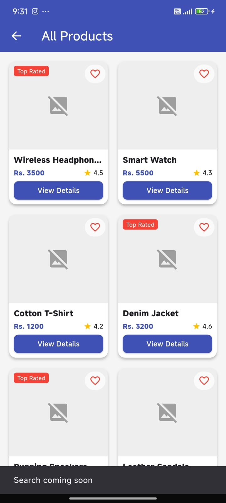

# MyShop - E-Commerce Flutter Application

**Student Name:** Samar Maharjan  
**Student ID:** 2510412186  
**Course:** Mobile Application Development  

## Description
MyShop is a feature-rich, responsive e-commerce mobile application built with Flutter and Material 3. It provides users with a seamless shopping experience, allowing them to browse products across multiple categories, view promotional banners, check detailed product descriptions, and interact with features such as favorites and shopping cart actions.

## Features
- **Home Dashboard:** Promotional banner carousel, horizontal category selector, and popular products section.
- **Category Browsing:** Filter products by categories (Electronics, Fashion, Shoes, Beauty, Accessories, Home) or view all products in a grid layout.
- **Product Details:** High-resolution image preview, pricing, star ratings, category info, detailed descriptions, and Add-to-Cart / Buy Now buttons.
- **Favorites & Interactions:** Toggle favorite items directly on product cards with instant state updates.
- **Safe Image Loading:** Graceful error handling for remote images with placeholders.

## Screenshots

|               Home Dashboard                |                    Product Details                     |            Category / All Products            |
|:-------------------------------------------:|:------------------------------------------------------:|:---------------------------------------------:|
|  |         |  |

## Packages Used
- `flutter` (SDK)
- `cupertino_icons` (^1.0.8)
- `flutter_test` (for unit and widget testing)
- `flutter_lints` (for code quality and lint rules)

## How to Run
1. Ensure Flutter SDK is installed on your machine.
2. Clone or open this repository in Android Studio or VS Code.
3. Install dependencies by running:
   ```bash
   flutter pub get
   ```
4. Connect an emulator or physical device, then run the app:
   ```bash
   flutter run
   ```
